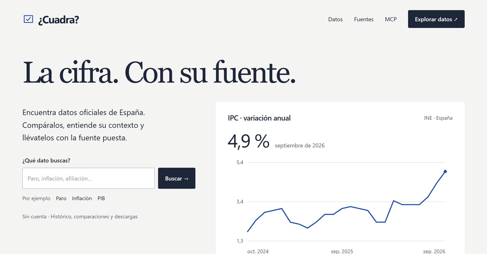

# Guillermo Martín de Oliva

**Behavioural data scientist · Python · R · SQL**

I analyse data and build applications, with a background in software testing and a postgraduate Master’s in Behavioural Data Science.

I’m particularly interested in using data for work with a clear social purpose: understanding problems that affect people’s lives, improving public services, and making public information easier to use.

Based in Seville, Spain · [Contact me on LinkedIn](https://www.linkedin.com/in/guillermo-martin-de-oliva/)

## My main project: ¿Cuadra?

A website for exploring Spain’s official statistics, comparing periods and downloading data with its sources. I’m developing it with guidance from a mentor, with parliamentary claim-checking as the next stage.

**[Explore ¿Cuadra?](https://cuadra-web.cuadra-datos.workers.dev/)** · Code is private

## Other projects

- **Population map of Lebanon** — An interactive demographic dashboard built in one week for a UN ESCWA technical assignment. I developed the data processing and web application, allowing users to explore population figures and trends by locality.

  [Explore the map](https://onulibanodashboard.netlify.app/) · [Code](https://github.com/Guille1799/lebanon-geo-dashboard)

- **Project RYSE** — My master’s final project, in a team of five, analysing League of Legends player performance. I led the technical work on the data, models and R Shiny dashboard.

  [Explore the dashboard](https://guillermomartindeoliva.shinyapps.io/ryse-lol-v2/) · [Earlier version’s code](https://github.com/Guille1799/ryse-publico)

- **Training and nutrition platform** — An application using Garmin activity data and food logs to plan training and nutrition. I developed the web application, backend and database, with automated tests covering its calculations. Private project.

- **[capa-normativa](https://github.com/Guille1799/capa-normativa)** — An open-source Python library linking the rules used in software to the research or regulations they come from.

- **[agent-gates](https://github.com/Guille1799/agent-gates)** — Open-source Python tools for checking the work of unattended AI coding agents.

## Previous experience

Almost three years in quality assurance for Santander’s supplier payments platform, checking financial data and calculations with SQL, investigating discrepancies with developers, and reporting results to the product team.
